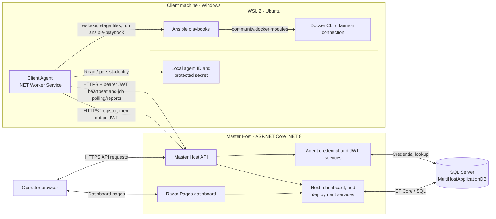
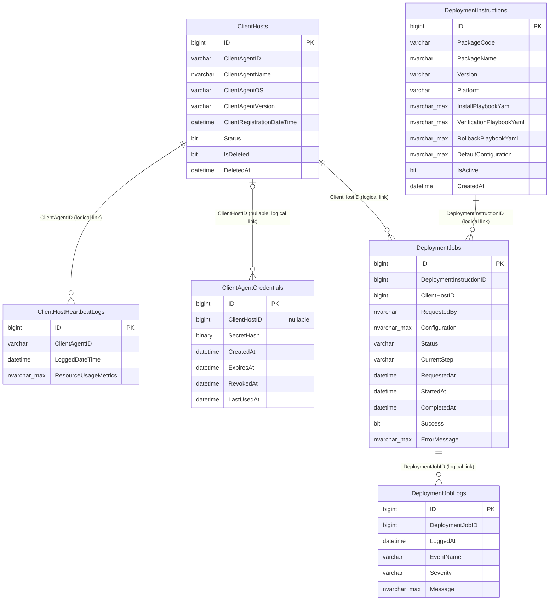

# Multi-Host Controller

The Multi-Host Controller is a .NET 8 application pair for registering client machines, receiving heartbeat/resource reports, and requesting application deployments. The Master Host provides the API and browser dashboard. Each Client Agent runs as a background worker, reports to the Master Host, and executes deployment playbooks through Ansible.

> **Current deployment note:** The Client Agent's Ansible runner invokes WSL. For the documented deployment workflow, run the agent on Windows with WSL 2, Ubuntu, Ansible, and access to Docker configured. The sample playbooks target the Docker daemon available to that agent's WSL distribution.

## Architecture

### Normal communication flow

1. An operator configures and starts the Master Host. It loads its SQL Server connection, API routes, dashboard, and JWT signing key.
2. An operator provisions a unique credential for each agent. The database stores the SHA-256 hash; the plaintext secret is supplied only to the matching agent.
3. At startup, the Client Agent loads or creates its persistent `client-agent-id`, protects and saves the supplied secret, then calls the registration endpoint.
4. The agent exchanges its ID and secret for a short-lived JWT. It keeps the access token in memory and reacquires it before expiry.
5. The agent sends heartbeat and resource metrics periodically. These are stored in the heartbeat log table and shown on the dashboard.
6. When an operator starts a deployment from a host's detail page, the Master Host creates a job. The agent polls, claims the job, runs install and verification playbooks, optionally runs rollback on failure, and reports progress/completion.

The API routes and payloads are in [API Documentation](docs/api-documentation.md). Database, key, credential, and application setup are in [Setup and Installation](docs/setup-installation-guide.md). Walkthroughs are in [Usage Examples](docs/usage-examples.md).

## Database tables and relationships

The application uses SQL Server database `MultiHostApplicationDB`. The script [docs/Multi-Host-Controller-Application-Database.sql](docs/Multi-Host-Controller-Application-Database.sql) creates the current tables and inserts a sample MinIO deployment instruction. It is a database creation script, not an idempotent migration: review it before running, especially if the database already exists.

### What each table stores

- **`ClientHosts`** — one registered agent identity and its current metadata/status. `IsDeleted` and `DeletedAt` implement soft deactivation.
- **`ClientHostHeartbeatLogs`** — timestamped heartbeat records and optional resource metrics. Its `ClientAgentID` is the external agent ID; the application uses it to associate entries with a host.
- **`ClientAgentCredentials`** — a hash of the provisioned agent secret. `ClientHostID` is nullable so an operator can insert a credential before first registration; registration binds it to the new host.
- **`DeploymentInstructions`** — package metadata and install, verification, optional rollback playbook YAML, plus optional default JSON configuration.
- **`DeploymentJobs`** — a requested run for one host and one instruction, including status, configuration, timestamps, and outcome.
- **`DeploymentJobLogs`** — chronological progress and result events for a deployment job.

## Projects

| Project | Purpose |
| --- | --- |
| `Multi-Host-Controller-Assessment/` | ASP.NET Core Master Host API and Razor Pages dashboard |
| `Client-Agent/` | .NET Worker Service for registration, heartbeats, job polling, and playbook execution |
| `tools/Provision-Agent-Credential.ps1` | Creates a random agent secret and corresponding SQL hash insert |

## Security and current limitations

- Agent APIs use short-lived JWTs, with secret-hash-backed enrollment. Configure HTTPS outside Development.
- The browser dashboard is currently unauthenticated. 
- The API deactivation endpoint requires an Admin-role token, but there is no admin login/token issuance flow in the current project.
- Ansible playbooks are executable deployment instructions with access to the local WSL/Docker environment. Limit who can add or change them and who can trigger jobs.

## Documentation

- [Setup and Installation](docs/setup-installation-guide.md)
- [Usage Examples](docs/usage-examples.md)
- [API Documentation](docs/api-documentation.md)
- [WSL and Docker Setup](docs/wsl-docker-setup.md)
- [Client Agent JWT Authentication](docs/client-agent-jwt-authentication.md)
